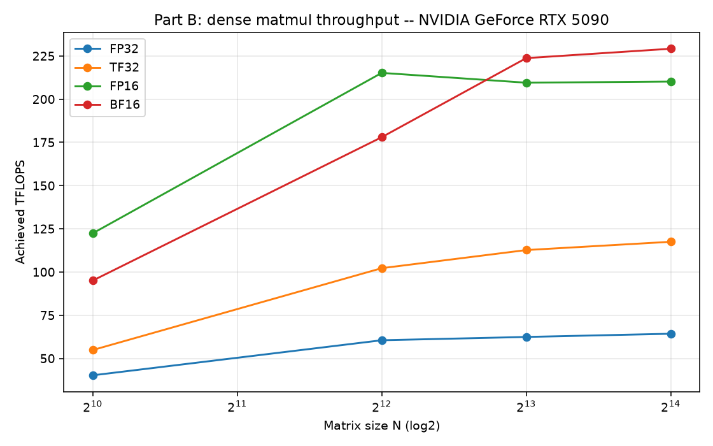
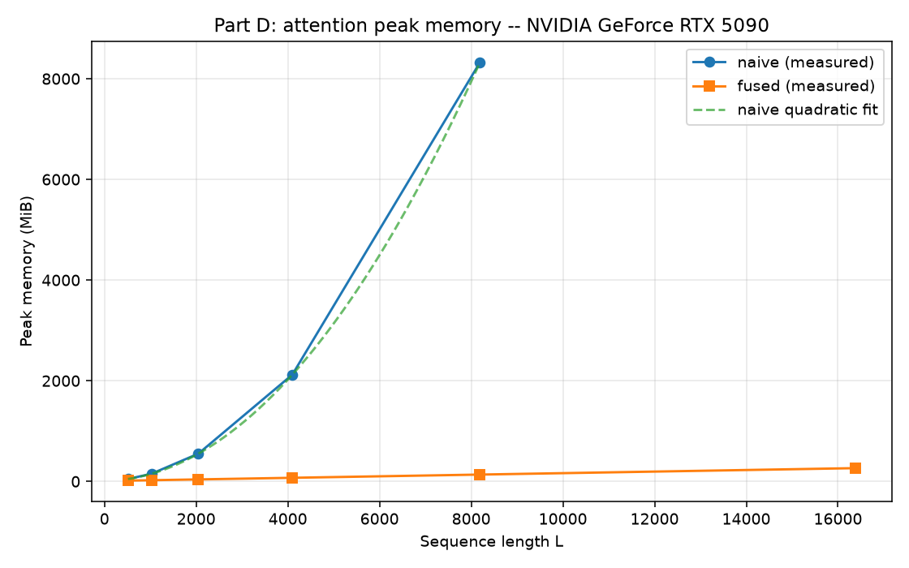
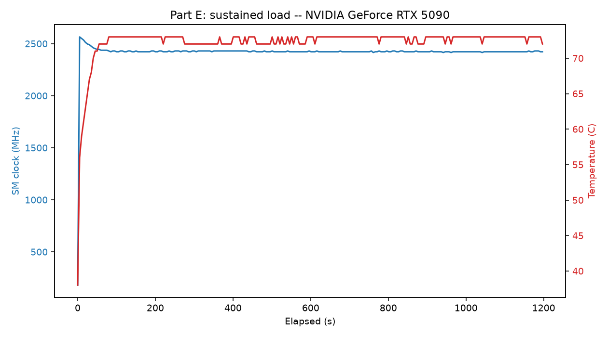

# METRICS.md — HW2.5

**GPU:** NVIDIA GeForce RTX 5090
**UUID:** `GPU-41051861-72ca-e198-fd60-2bf89fd2a67b`
**Driver:** 595.95 **CUDA (driver):** 13.2 **Driver model:** WDDM
**VRAM:** 32607 MiB GDDR7 **Power cap:** 575 W
**Stack:** PyTorch 2.11.0+cu128 (native sm_120 confirmed), Python 3.12

All measurements below come from runs on this UUID. Raw data:
`part_b_<UUID>.csv`, `part_c_<UUID>.csv`, `part_d_<UUID>.csv`,
`part_e_samples_<UUID>.csv`, `part_e_throughput_<UUID>.csv`; run lines in
`RUN_LOG.txt`.

---

## Part A — Card specification

| Property | RTX 5090 | Source |
|----------|----------|--------|
| Architecture | Blackwell, GB202 die; 5th-gen Tensor Cores, 4th-gen RT Cores | RTX Blackwell whitepaper |
| Memory type / capacity | GDDR7, 32 GB, 512-bit bus | RTX Blackwell whitepaper / 5090 spec page |
| Memory bandwidth | 1792 GB/s | RTX 5090 spec page |
| Tensor core generation | 5th generation | RTX Blackwell whitepaper |
| Reduced precisions (tensor) | TF32, BF16, FP16, FP8 (2nd-gen Transformer Engine), FP6, FP4, INT8, INT4 | RTX Blackwell whitepaper |
| Reference boost clock | 2.41 GHz | RTX 5090 spec page (used as ref_clock for the Part B clock-correction) |

**Source documents:**
- **NVIDIA RTX Blackwell GPU Architecture whitepaper (V1.1)** —
  https://images.nvidia.com/aem-dam/Solutions/geforce/blackwell/nvidia-rtx-blackwell-gpu-architecture.pdf
  (the GeForce/consumer paper — architecture, 5th-gen Tensor Cores, GB202,
  supported precisions incl. FP4/FP6, GDDR7). NOT the "RTX PRO Blackwell"
  workstation paper, NOT the datacenter Blackwell/B200 paper.
- **GeForce RTX 5090 product page (specifications)** —
  https://www.nvidia.com/en-us/geforce/graphics-cards/50-series/rtx-5090/
  (32 GB GDDR7, 512-bit, 1792 GB/s, 2.41 GHz reference boost clock, 575 W).

**Dense theoretical peaks used for "% of peak"** (FP32-accumulate; verify vs the
cited whitepaper — headline figures are usually 2:4 sparse = 2× these):
FP32 104.8, TF32 104.8, BF16 209.5, FP16 209.5, FP8 419.0 TFLOPS.

### Reservation & GPU-hours

- **Facility:** SJSU HPC lab, ISB 838, Machine 16 (single allocated card).
- **Reserved window:** Mon 14 Sep 2026, 12:00 PM PDT → 11:59 AM +1 day — a
  1-day reservation (≈ 24 GPU-hours reserved on the allocated card).
- **GPU-hours consumed:** ≈ 0.75 h of active benchmarking. `RUN_LOG.txt` spans
  21:57–22:41 UTC (~44 min), covering Parts B–E including the 20-minute Part E
  sustained run; remaining lab time was environment setup.
- **Card:** RTX 5090, UUID `GPU-41051861-72ca-e198-fd60-2bf89fd2a67b` (full
  `nvidia-smi -q` in `nvidia_smi_5090.txt`).

---

## Table HW2.5.1 — Summary

| Measurement | RTX 5090 | Notes / traceability |
|-------------|----------|----------------------|
| Peak achieved TFLOPS (BF16) | **229.2** | N=16384, cold. `part_b` CSV. Boost ~2580 MHz |
| % of theoretical peak (BF16) | **109.4%** | vs 209.5 dense peak; >100% = boost clock above reference. Clock-corrected (2422 MHz steady) ≈ 100% |
| Effective bandwidth (GB/s) | **1552.9** | 86.7% of 1792 spec; elementwise add. `part_c` CSV |
| Naive attention OOM length | **16384** | largest OK 8192; config B=1/H=32/D=64/fp16. `part_d` CSV |
| Fused attention OOM length | **>16384** | no OOM in tested range (264 MiB @16384) |
| Steady-state / peak throughput | **95.4%** | peak(30s) 211.8 → steady(5min) 202.0 TFLOPS. `part_e` CSVs |
| Throttle onset (s) | **60 s** | power-limited (575 W cap, 71 °C); not thermal |

---

## Part B — Precision and throughput

Achieved dense TFLOPS (N=16384): FP32 64.3, TF32 117.5, FP16 210.2, BF16 229.2.
Tensor cores engage clearly (TF32/FP16/BF16 ≫ FP32). Small N=1024 never
plateaus — too little arithmetic per byte, so kernel-launch and memory traffic
dominate; each precision plateaus by N≈4096–8192 where the GEMM is compute-bound
and the tensor cores stay fed.

**Above-100% percentages (TF32 112%, BF16 109%, FP16 ~100%) are a boost-clock
effect, not sparsity.** The datasheet peak is quoted at NVIDIA's ~2.4 GHz
reference boost; a cold card boosts to ~2580 MHz on a short benchmark and beats
it. Using the Part E steady clock (2422 MHz) as a clock-corrected reference
brings all figures ≤100%. (BF16 edging above FP16 is kernel selection + clock
drift across the sweep, not a real rate difference.)

**Figure B1** — Achieved dense TFLOPS vs matrix size N (one line per precision).

Tensor-core precisions (TF32/FP16/BF16) separate clearly above FP32; each
plateaus by N≈4096–8192 where the GEMM is compute-bound, while N=1024 never
reaches its plateau. FP16 peaks at N=4096 (~215) then holds ~210; BF16 climbs to
229 at N=16384.

## Part C — Roofline

Ridge point 58.5 FLOP/byte (FP32 peak 104.8 TFLOPS ÷ 1792 GB/s).
- **Memory-bound:** elementwise add — 1552.9 GB/s (86.7% of spec),
  AI ≈ 0.083 FLOP/byte → far left of ridge.
- **Compute-bound:** FP32 matmul (N=8192) — 65.4 TFLOPS,
  AI ≈ 1365 FLOP/byte (min-traffic estimate) → far right of ridge.

The matmul AI is a lower bound (ignores L2/shared-memory reuse), so true AI is
higher still — deeper into compute-bound territory. Note the ridge moves right
for lower precision (BF16 roof ~2×), so more ML work sits bandwidth-bound than
the FP32 roofline implies.

## Part D — Cost of attention

Config: batch=1, heads=32, head_dim=64, fp16.

Peak memory is quadratic in L, confirmed from the data: fitting a·L² + b·L + c
gives **a = 128.000 bytes/L²**, matching the prediction 4·B·H exactly — i.e.
two fp16 L×L matrices (scores + softmax probabilities) per batch·head. (A second
run at heads=8 gave a = 32.000 = 4·1·8, confirming a scales linearly with heads.)

OOM boundary (naive): largest success L=8192 (8328 MiB), smallest failure
L=16384 — a clean CUDA OOM, since sysmem fallback was disabled (verified: a
prior run with fallback on "fit" 33 GB on a 32 GB card at 289 ms, a system-RAM
spill). Reported as a range; not searched to single-token resolution.

Fused (Flash/mem-efficient SDPA) memory is ~linear (264 MiB @ L=16384) and does
not OOM in range. Speedup where both fit: 1.28× (512) → 3.67× (8192), widening
with L because the fused kernel never materializes the L×L matrices — it tiles
Q/K/V and streams an online softmax (running max + sum) in SRAM, avoiding the
O(L²) global-memory traffic and allocation. Beyond L=8192 the win is
qualitative: fused runs lengths naive cannot.

**Figure D1** — Attention peak memory vs sequence length (config B=1/H=32/D=64/fp16).

Naive (blue) is quadratic in L and tracks the dashed a·L²+b·L+c fit; it stops at
L=8192 because L=16384 OOMs. Fused (orange) is near-flat — 264 MiB at L=16384,
where naive would need ~34 GB.

## Part E — Sustained load and thermal

20-minute fp16 N=8192 load, sampled every 5 s. Cold-boost SM clock 2580 MHz →
steady 2422 MHz (93.9%). Throughput peak(30s) 211.8 → steady(5min) 202.0 TFLOPS
(**95.4%**). Temperature 35 °C → 73 °C max; power pinned at the **575 W cap**.

The card is **power-limited, not thermal-limited**: 73 °C is well below the
thermal-throttle point, but power sits at the board cap, so the clock backs off
to stay within budget. Throttle onset ≈ 60 s (when the sustained clock first
falls below 95% of cold boost). This is card/chassis/room-specific.

**Figure E1** — SM clock and temperature vs time over the 20-minute load.

SM clock spikes to the cold boost (~2580 MHz) then settles to ~2422 MHz within
~60 s as temperature climbs to ~72 °C and power pins at the 575 W cap — the
clock backs off to stay under the power ceiling (power-limited, not thermal).
The temperature sawtooth at ~71–73 °C is the steady-state power-limited regime.
